# 学生量化管理（寄宿制高中）

面向大陆寄宿制高中的量化管理系统。**老师**按班级或宿舍找到学生，一键加扣分、登记重大违纪、审批请假、发布考试成绩和通知；**家长**打开就能看到孩子在校状态、量化分、最新成绩和学校通知，并在线请假。

- **前端**：[uni-app](https://uniapp.dcloud.net.cn/)（Vue 3）一套代码，现在编译成 **H5 网页**测试和使用，以后直接编译成**微信小程序**上线。界面参考 iOS「设置」和飞书：浅灰底 + 白色圆角卡片分组，藏青色为品牌色；网页版的提示框、操作菜单、轻提示都做成了 iOS 风格（小程序里用微信原生弹窗）；支持深色模式。
- **量化行情**：把学生的量化分当成「股价」，每天的加扣分画成 K 线，班级平均分是「指数」，各班是「板块」，有涨幅榜、热力图、日 K / 周 K、均线，红涨绿跌（可切换）。
- **后端**：Node.js + SQLite，单个进程同时提供 API 和网页，一条 `docker compose up` 即可部署。
- **登录**：接入你自己的身份平台（OIDC / OAuth 2.0），另有演示账号方便测试，小程序可绑定微信免登录。
- 只有**教师**和**家长**两类用户（管理员是有后台权限的教师）。宿管、门卫等不需要账号，宿舍情况由班主任汇总录入。

| 教师首页 | 按宿舍选人 | 重大违纪 | 记分 | 学生档案 |
| --- | --- | --- | --- | --- |
| 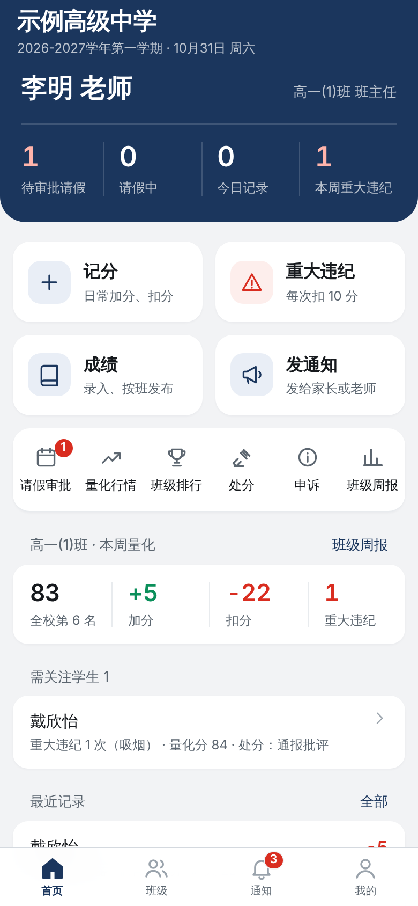 | 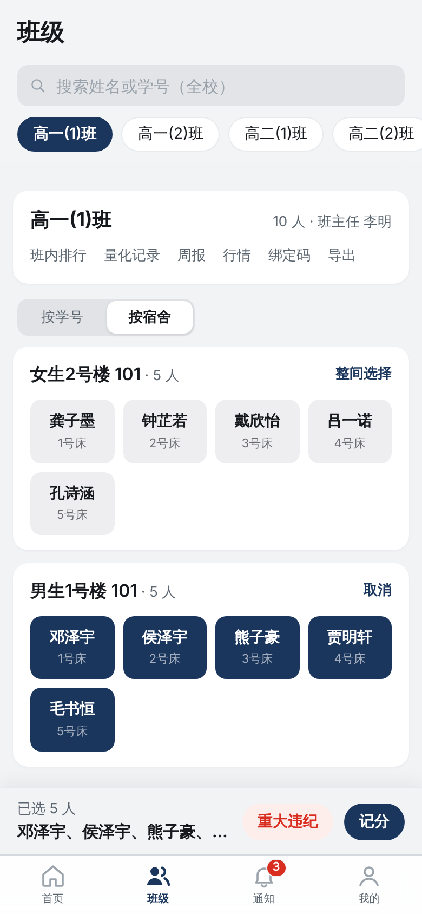 | 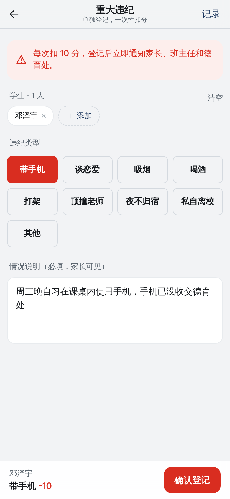 | 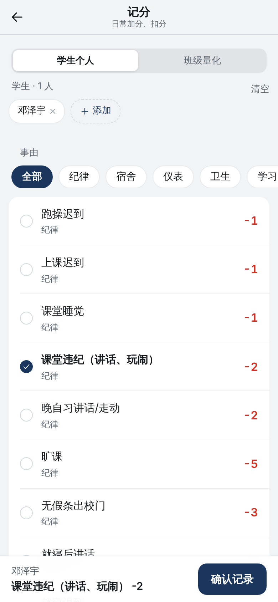 | 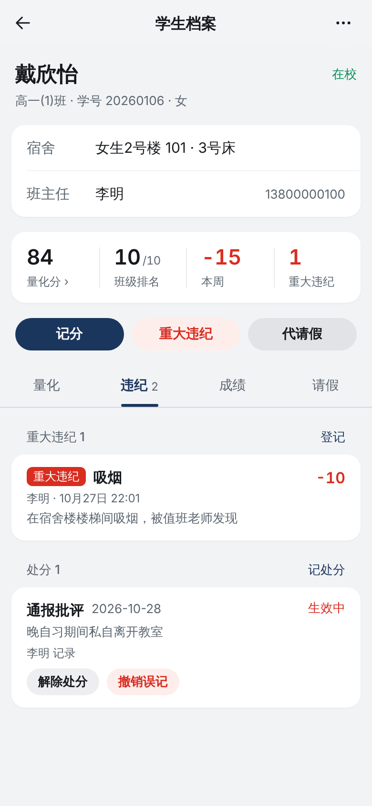 |

| 量化行情 | 全校板块 | 个股 K 线 | 深色模式 | 提示框 |
| --- | --- | --- | --- | --- |
| 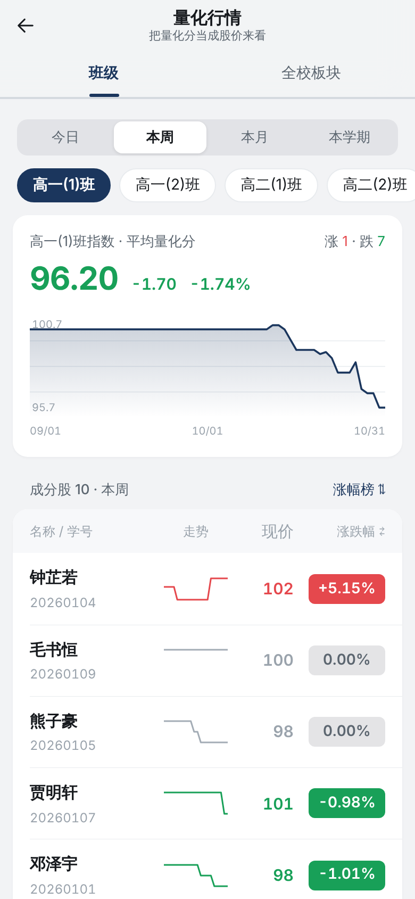 | 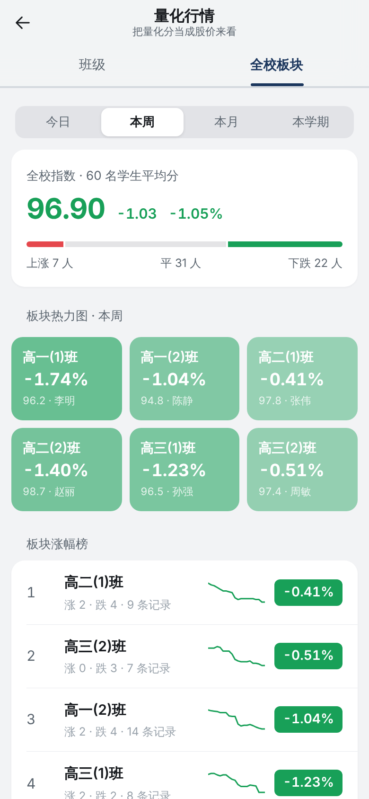 | 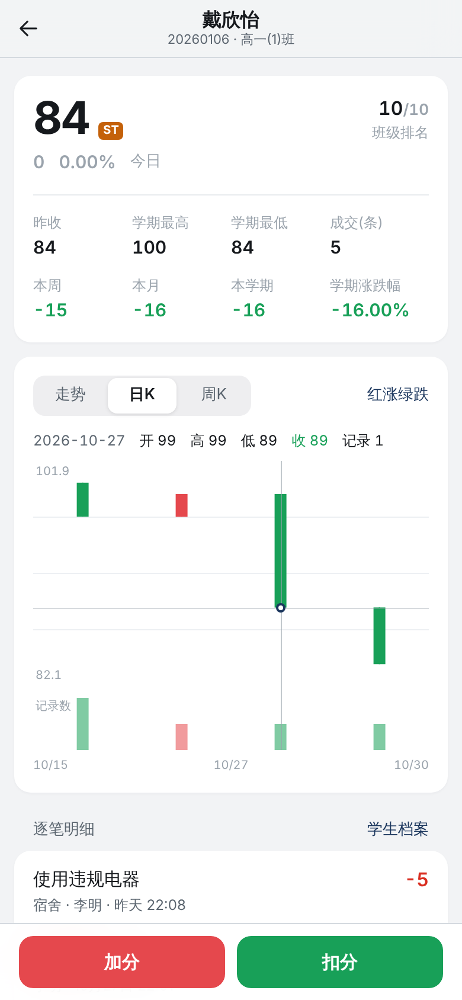 | 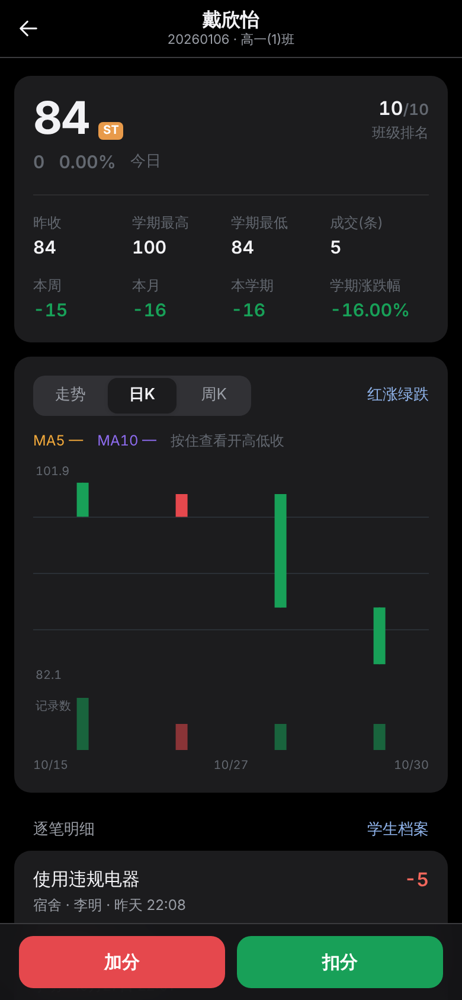 | 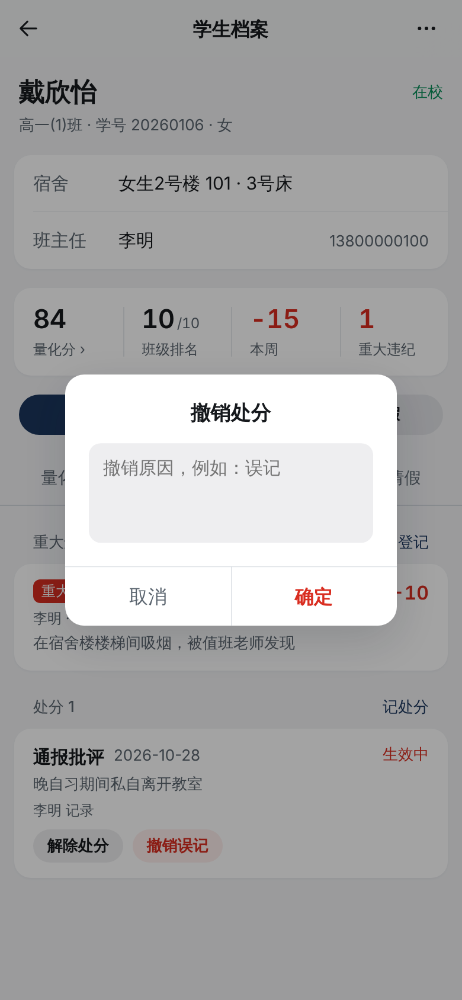 |

| 家长首页 | 家长首页（下） | 学校通知 | 成绩单 | 发布成绩 |
| --- | --- | --- | --- | --- |
| 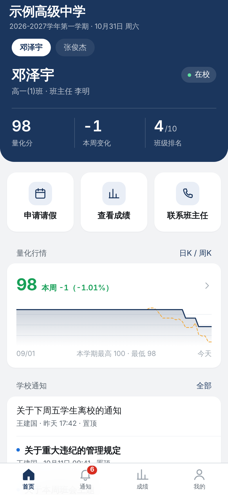 | 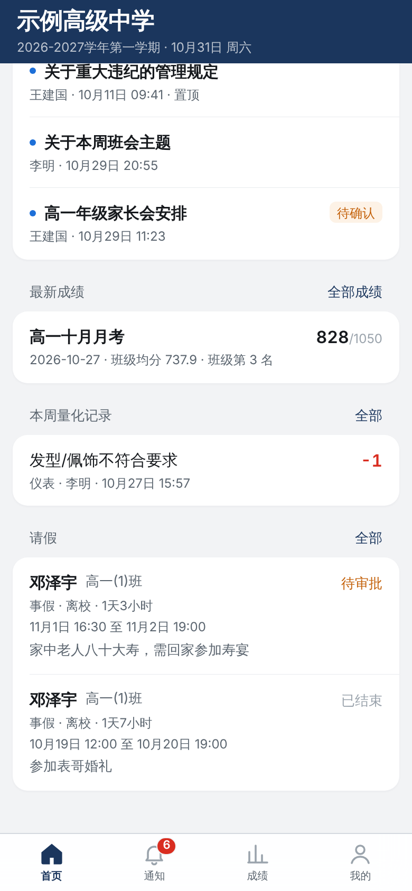 | 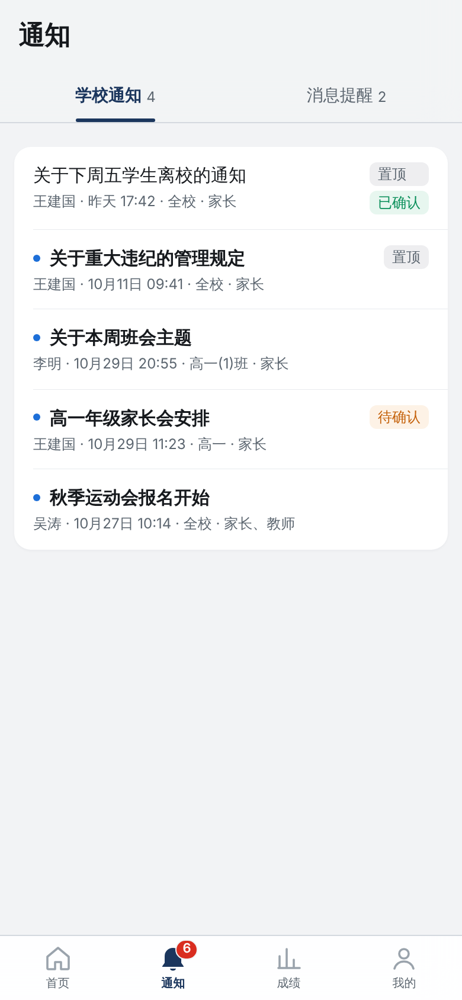 | 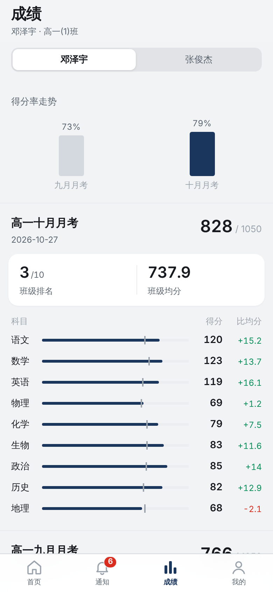 | 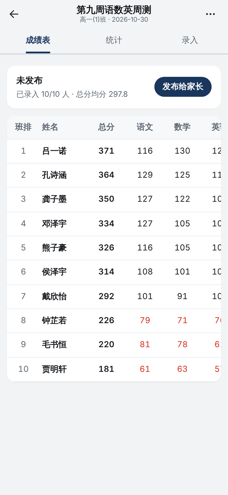 |

| 请假审批 | 班级周榜 | 班级周报 | 申诉处理 | 登录 |
| --- | --- | --- | --- | --- |
| 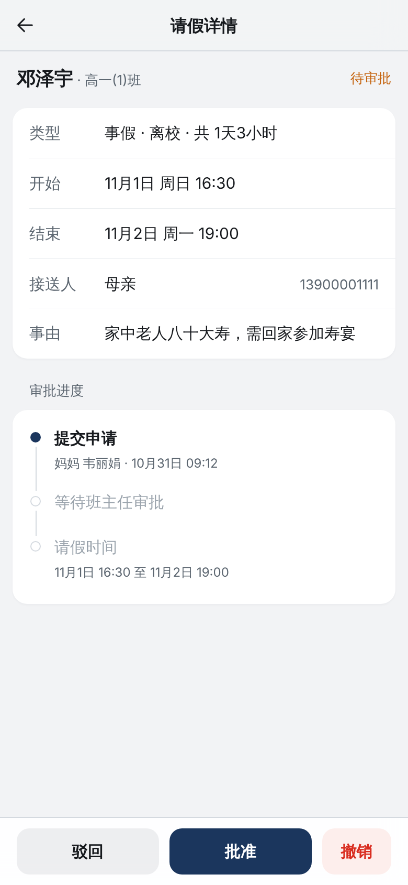 | 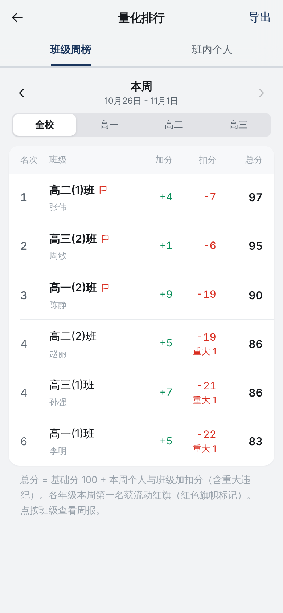 | 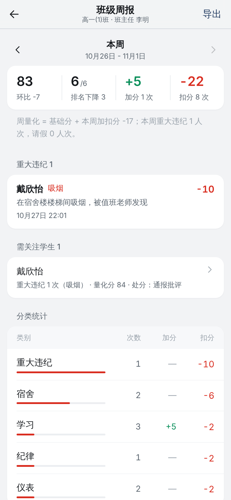 | 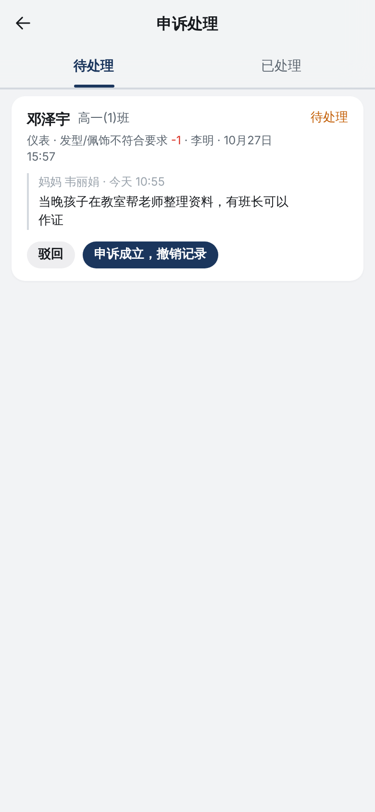 | 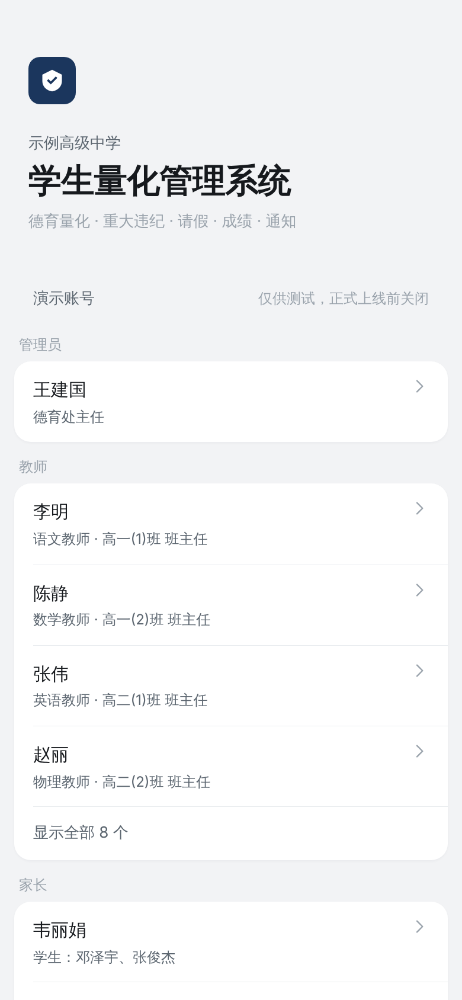 |

## 功能

**教师**（底部四个标签：首页 / 班级 / 通知 / 我的）
- **找人快**：「班级」页按学号或**按宿舍**列出全班，可多选、整间宿舍一键全选，选好后直接「记分」或「重大违纪」；也可以全校搜索姓名、学号
- **日常记分**：按细则一键加扣分，一次可记多名学生，也可以给班级整体记分；记录人或班主任可撤销误记
- **重大违纪**：带手机、谈恋爱、吸烟、喝酒、打架、顶撞老师、夜不归宿、私自离校等单独登记，**每次一次性扣 10 分**（可设置），必须写明情况；立即通知家长、班主任和德育处（管理员）。重大违纪在学生档案、班级周报、班级周榜、需关注名单中单独显示和统计
- **处分**：通报批评 / 警告 / 严重警告 / 记过 / 记大过 / 留校察看；班主任可解除，记录人可撤销
- **请假**：家长在线申请，班主任一键批准或驳回；班主任也可代为登记（直接生效）；首页显示待审批和正在请假的人数
- **成绩发布**：教务（管理员）建年级考试，班主任也可为本班建周测；任课老师按班录入或**从 Excel 粘贴**；**班主任核对后按班「发布给家长」**，家长立刻收到通知，发现错误可撤回；成绩表、排名、各科均分、及格率、优秀率、各班对比
- **通知**：按全校 / 年级 / 班级向家长或教师发布，可要求「确认收到」并查看未确认名单
- **首页**：待审批请假、请假中、今日记录、本周重大违纪；本班本周量化与全校排名；需关注学生；最近记录
- **量化行情**（首页「量化行情」或班级页「行情」）：班级指数走势与成分股列表（现价、迷你走势、涨跌幅），可看今日 / 本周 / 本月 / 本学期的涨幅榜、跌幅榜；「全校板块」是各班的热力图和涨幅榜；点进学生是个股页：走势、日 K、周 K、5 日 / 10 日均线、成交量（记录数），按住图表看当天开高低收，底部「加分 / 扣分」直接记分。本学期有重大违纪的学生名字前标「ST」（只有老师看得到）
- **班级周榜与周报**：班级周量化与流动红旗；周报含本周量化与上周对比、分类统计、重大违纪明细、扣分较多与表现突出的学生，适合班会和德育例会
- **需关注学生**：本学期有重大违纪、量化分低于阈值、本周扣分频繁、有生效处分的学生自动列出（阈值可设置）
- **家长申诉处理**：家长对扣分有异议可申诉，班主任/记录人核实后「申诉成立」自动撤销记录，或填写理由驳回
- **导出 Excel**：班级周榜、班级名单（含量化分、重大违纪次数）、量化明细、考试成绩表（含学科统计）、请假记录
- **家长绑定码**：班主任一键查看、复制全班绑定码

**家长**（底部四个标签：首页 / 通知 / 成绩 / 我的）
- **首页一眼看全**：孩子在校 / 请假状态、量化分、本周变化、班级排名；有重大违纪时醒目提示；申请请假、查看成绩、联系班主任三个大按钮；学校通知、最新成绩、本周量化记录、请假进度
- **学校通知**与**消息提醒**分开：通知是学校发布的公告，提醒是与孩子有关的加扣分、重大违纪、请假审批、成绩发布
- 查看各次考试成绩、各科与班级均分对比、得分率走势；多个孩子一键切换
- **孩子的量化行情**：首页有本学期走势小图（虚线是班级平均），点开是孩子自己的日 K / 周 K，看不到其他学生
- 对 7 天内（可设置）的扣分提出申诉

**管理员**：班级、学生（批量导入）、教职工（邀请码）、宿舍、量化细则与重大违纪类型、学期与基础分、重大违纪扣分、预警阈值、申诉期限、家长端排名可见范围；**操作日志**记录每一次记分、重大违纪登记、撤销、审批、成绩修改与发布

## 快速开始（本地试用）

需要 Node.js ≥ 22.13。

```bash
npm run setup      # 安装依赖
npm run build      # 构建 H5 前端
npm start          # 启动，打开 http://localhost:8787
```

首次启动会自动写入演示数据（6 个班、60 名学生、教师、家长、三周的量化记录、几条重大违纪、考试成绩等）。登录页列出了所有演示账号，点一下即可以该身份登录，例如：

- **王建国**：管理员（德育处主任）
- **李明**：高一(1)班班主任（有一场本班周测等待发布）
- **郑华**：数学教师，任教高一(1)班和高二(1)班（不是班主任）
- **韦丽娟**：家长（两个孩子，分别在高一和高三；高三的孩子有一条重大违纪）

升级说明：旧版本的数据库会在启动时自动升级（已发布的考试转为各班已发布，离校/返校状态并入「已批准」）。如果只是试用，也可以直接 `npm run seed` 重置演示数据。

登录页最上面是「**用 e 登录**」（应用「学生量化管理」的 client_id 已内置，e 上登记了本机回调地址 `http://localhost/auth/e/callback`）。本机测试请用 **http://localhost:8787** 打开，不要用 127.0.0.1。第一次用 e 登录后，老师输入管理员给的邀请码、家长输入孩子的绑定码，认领学校里的身份。

开发时可以前后端分开热更新：`npm run dev:server` 和 `npm run dev:web`（打开 http://localhost:5173）。

重置演示数据：`npm run seed`（会清空数据库）。运行测试：`npm test`。

## 接入你的登录平台

**用 e 账户登录（yeraldo.com）已按 e 的接入规范接好**：在 <https://yeraldo.com/developers> 创建应用，登记回调地址 `https://你的域名/auth/e/callback`，`.env` 里填 `E_CLIENT_ID`（需要检查内测资格时再填 `E_BETA_SOFTWARE`）。网页版直接跳转登录，微信小程序用「浏览器扫码登录 e、小程序自动等结果」的方式。详见 [docs/AUTH.md](docs/AUTH.md#用-e-账户登录yeraldocom)。

此外也支持任何提供 **OIDC 或 OAuth 2.0 授权码模式** 的平台（Casdoor、Logto、Authing、Keycloak、自建 SSO 等）。在平台中登记回调地址 `https://你的域名/api/auth/oidc/callback`，然后在 `.env` 中填写：

```ini
AUTH_ISSUER=https://你的平台地址
AUTH_CLIENT_ID=...
AUTH_CLIENT_SECRET=...
AUTH_LABEL=使用 XX 平台登录
```

用户第一次登录后，教师输入管理员给的**邀请码**、家长输入班主任给的**学生绑定码**完成身份绑定；如果平台本身就管理角色，也可以直接映射。详见 **[docs/AUTH.md](docs/AUTH.md)**。

## 部署与上线小程序

见 **[docs/DEPLOY.md](docs/DEPLOY.md)**，包括：

- Docker 一键部署、Nginx + HTTPS、数据备份
- 先在海外免费平台部署给大陆的朋友试用
- 编译微信小程序并交给有大陆身份的朋友注册、上传、审核（需要小程序主体和备案域名）

## 目录结构

```
app/                  uni-app 前端（H5 + 微信小程序）
  src/pages/          页面：首页、记分、重大违纪、量化行情、学生档案、请假、成绩、通知、排行……
  src/admin/          管理后台（小程序分包）
  src/views/          首页各标签页：首页、班级、通知、成绩、我的（按角色显示）
  src/components/     组件：导航栏、标签、底部栏、记录行、成绩单、学生选择器、K 线图……
  src/utils/          请求、登录状态、格式化、图标、行情图表（生成 SVG，H5 与小程序通用）
server/               Node.js 后端
  src/routes/         量化与重大违纪、处分、请假、成绩、通知、学校数据、首页概览、周报预警、申诉、导出、量化行情
  src/xlsx.js         无依赖的 .xlsx 生成器
  src/auth.js         登录（身份平台 / 演示 / 微信）
  src/seed.js         演示数据
  test/               接口测试（含模拟身份平台的完整登录流程）
docs/                 部署、登录接入文档与截图
```

## 常见问题

- **量化分怎么算？** 学生量化分 = 基础分（默认 100）+ 本学期所有未撤销的加扣分（含重大违纪）。班级周量化 = 班级基础分 + 本周个人与班级加扣分。基础分、学期开始日期、重大违纪扣分都在「管理后台 → 系统设置」修改。
- **重大违纪和普通扣分有什么区别？** 重大违纪有单独的登记入口和类型列表，分值统一（默认每次 10 分），必须写情况说明，会同时通知家长、班主任和德育处；在学生档案、周报、周榜里单独计数，不会和日常扣分混在一起。
- **成绩什么时候家长能看到？** 班主任在成绩页点「发布给家长」之后，按班发布；同一场年级考试，各班可以分别核对、分别发布。
- **宿管、值周老师怎么办？** 不需要单独的账号。宿舍和值周发现的问题交给班主任，班主任在「班级 → 按宿舍」里选人统一录入即可。如果需要，也可以给他们开普通教师账号。
- **家长能看到排名吗？** 默认只显示班级排名，可在设置中改为不显示或同时显示年级排名。
- **数据存在哪？** 一个 SQLite 文件（默认 `server/data/lianghua.db`，Docker 部署时在 `./data`），备份时复制该文件即可。
